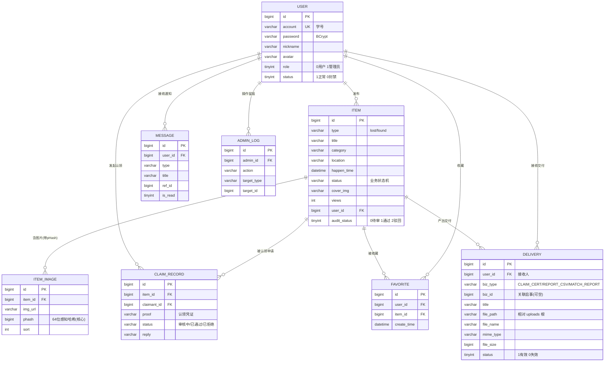

# 校园失物招领平台 · 数据库设计（E-R 与数据字典）v1.0

> 交付物编号 06（对应分工方案 成员E · 数据库及文档）。
> 数据库：`lost_found`（MySQL 8+/9.x，InnoDB，utf8mb4）。
> 建表脚本：`backend/src/main/resources/db/schema.sql`；演示数据由 `DataInitializer` 启动时幂等播种（Z-06 起 data.sql 已删除）。

---

## 一、E-R 图（文字描述 + Mermaid）

实体共 8 个：用户(user)、启事(item)、启事图片(item_image)、认领记录(claim_record)、站内消息(message)、管理员日志(admin_log)、收藏(favorite，E-07)、交付文件(delivery，P1 新增)。

关系：
- user 1—N item（一个用户可发布多条启事）
- item 1—N item_image（一条启事可有多张图片；**item_image 携带 64 位 pHash 指纹，是以图搜图的核心**）
- item 1—N claim_record（一条启事可收到多条认领申请）
- user 1—N claim_record（一个用户可发起多条认领申请）
- user 1—N message（一个用户可收到多条站内消息）
- user 1—N admin_log（管理员操作留痕）
- user 1—N favorite；item 1—N favorite（E-07：一人一启事仅一条，唯一键保证幂等）
- user 1—N delivery（P1：交付接收人）；item 1—N delivery（按 biz_id 关联，删启事时级联清理）



---

## 二、数据字典

### 2.1 user（用户表）
| 字段 | 类型 | 约束 | 说明 |
|---|---|---|---|
| id | BIGINT | PK, AUTO | 用户ID |
| account | VARCHAR(20) | UNIQUE, NOT NULL | 学号（登录账号，6-12 位数字） |
| password | VARCHAR(100) | NOT NULL | BCrypt 加密后的密码 |
| nickname | VARCHAR(30) | NOT NULL | 昵称 |
| avatar | VARCHAR(16) | NOT NULL | 头像（emoji） |
| phone | VARCHAR(20) | NULL | 联系电话（选填；E-01 启用：进入资料编辑口径，认领申请联系方式处可快捷填入，此前为有字段无使用的死字段） |
| role | TINYINT | NOT NULL, 默认0 | 0=普通用户 1=管理员 |
| status | TINYINT | NOT NULL, 默认1 | 1=正常 0=封禁 |
| create_time / update_time | DATETIME | 默认 CURRENT_TIMESTAMP | 注册/更新时间 |

### 2.2 item（失物/招领启事表）
| 字段 | 类型 | 约束 | 说明 |
|---|---|---|---|
| id | BIGINT | PK, AUTO | 启事ID |
| type | VARCHAR(10) | NOT NULL | lost=寻物启事 / found=招领启事 |
| title | VARCHAR(60) | NOT NULL | 物品名称/标题 |
| category | VARCHAR(20) | 默认'其他' | 分类（证件卡类/钥匙/电子设备/书籍资料/衣物饰品/其他） |
| location | VARCHAR(50) | | 地点 |
| happen_time | DATETIME | | 丢失/捡到时间 |
| description | VARCHAR(500) | | 详细描述 |
| status | VARCHAR(20) | 默认'寻找中' | 业务状态（见状态机） |
| cover_img | VARCHAR(255) | | 封面图相对路径（/uploads/...） |
| views | INT | 默认0 | 浏览量 |
| user_id | BIGINT | NOT NULL, FK→user.id | 发布人 |
| audit_status | TINYINT | 默认1 | 0=待审核 1=已通过 2=已驳回 |
| create_time / update_time | DATETIME | | 发布/更新时间 |

索引：`idx_type_status(type,status)`、`idx_category(category)`、`idx_user(user_id)`、`idx_create_time(create_time)`。

**索引取舍说明（审查 2.18/2.32）**：① 关键词检索实现采用 `LIKE '%k%'`（QueryWrapper 不支持全文语法），故**不建** ngram 全文索引，避免"文档说了但代码没做"——数据量上来后再评估 `MATCH...AGAINST`；② `item_image.phash` 上**不建普通索引**：检索条件是函数 `BIT_COUNT(phash ^ q)`，普通 B+Tree 索引永远不会被命中（EXPLAIN 已证实），建了只是写放大；更大规模时改用"分段哈希+前缀索引"预筛。此取舍已写入测试报告/答辩 Q&A。

### 2.3 item_image（启事图片表 · 以图搜图核心）
| 字段 | 类型 | 约束 | 说明 |
|---|---|---|---|
| id | BIGINT | PK, AUTO | 图片ID |
| item_id | BIGINT | NOT NULL, FK→item.id | 所属启事 |
| img_url | VARCHAR(255) | NOT NULL | 图片相对路径 |
| **phash** | **BIGINT** | —（不建索引，见上方取舍说明） | **64 位感知哈希（有符号 long 存储）**；汉明距离 = `BIT_COUNT(phash ^ 查询hash)` |
| sort | INT | 默认0 | 图片顺序 |
| create_time | DATETIME | | 创建时间 |

> 设计要点（风险预置#7）：图片本体存磁盘 `uploads/yyyy/MM/uuid.jpg`，库中只存路径 + 64 位哈希，避免撑爆数据库/仓库。

### 2.4 claim_record（认领申请表）
| 字段 | 类型 | 约束 | 说明 |
|---|---|---|---|
| id | BIGINT | PK, AUTO | 认领记录ID |
| item_id | BIGINT | NOT NULL, FK→item.id | 启事ID |
| claimant_id | BIGINT | NOT NULL, FK→user.id | 申请人 |
| proof | VARCHAR(300) | NOT NULL | 认领凭证（只有失主知道的特征） |
| contact | VARCHAR(50) | | 联系方式 |
| status | VARCHAR(20) | 默认'审核中' | 审核中/已通过/已拒绝 |
| reply | VARCHAR(200) | | 发布者回复 |
| create_time / update_time | DATETIME | | 申请/处理时间 |

### 2.5 message（站内消息表）
| 字段 | 类型 | 约束 | 说明 |
|---|---|---|---|
| id | BIGINT | PK, AUTO | 消息ID |
| user_id | BIGINT | NOT NULL, FK→user.id | 接收人 |
| from_user_id | BIGINT | NULL, FK→user.id | 发送者ID（E-03：NULL=系统消息，dm 恒有值，支持双向回复；加列 DEFAULT NULL 对存量数据零影响） |
| type | VARCHAR(20) | 默认'system' | claim/audit/dm/system（E-02 起审核/下架通知写 audit，E-03 私信写 dm） |
| title / content | VARCHAR(100/300) | | 标题/内容 |
| ref_id | BIGINT | | 关联业务ID |
| is_read | TINYINT | 默认0 | 0未读 1已读 |
| create_time | DATETIME | | 创建时间 |

### 2.6 admin_log（管理员日志表）
| 字段 | 类型 | 约束 | 说明 |
|---|---|---|---|
| id | BIGINT | PK, AUTO | 日志ID |
| admin_id | BIGINT | NOT NULL, FK→user.id | 管理员 |
| action | VARCHAR(50) | NOT NULL | audit/offline/ban/delete |
| target_type / target_id | VARCHAR(20)/BIGINT | | 目标类型/ID |
| detail | VARCHAR(300) | | 详情 |
| create_time | DATETIME | | 操作时间 |

### 2.7 favorite（启事收藏表，E-07 新增）
| 字段 | 类型 | 约束 | 说明 |
|---|---|---|---|
| id | BIGINT | PK, AUTO | 收藏ID |
| user_id | BIGINT | NOT NULL, FK→user.id | 收藏人 |
| item_id | BIGINT | NOT NULL, FK→item.id | 启事 |
| create_time | DATETIME | | 收藏时间 |

> 唯一索引 `uk_user_item(user_id, item_id)` 保证收藏幂等；启事删除时由 Service 层级联清理收藏行（与 message 同策略，无物理外键）。

### 2.8 delivery（交付文件表，P1 新增）
| 字段 | 类型 | 约束 | 说明 |
|---|---|---|---|
| id | BIGINT | PK, AUTO | 交付ID |
| user_id | BIGINT | NOT NULL, FK→user.id | 接收人（下载/打开仅限本人，管理员豁免） |
| biz_type | VARCHAR(32) | NOT NULL | CLAIM_CERT 认领证明 / REPORT_CSV 统计报表 / MATCH_REPORT 匹配报告 |
| biz_id | BIGINT | NULL, FK→item.id | 关联启事（删除时级联清理行+盘） |
| title / description | VARCHAR(128/255) | | 卡片标题/副文案 |
| file_path | VARCHAR(512) | NOT NULL | 相对 uploads 根：deliveries/yyyy/MM/uuid.ext（**永不下发绝对路径，服务端按 id 读回**） |
| file_name / mime_type / file_size | VARCHAR(255)/VARCHAR(128)/BIGINT | | 展示文件名 / MIME 白名单三类 / 字节数 |
| status | TINYINT | 默认1 | 1有效 0失效 |
| create_time | DATETIME | | 创建时间 |

> 设计出处：DeepSeek Harness 的"业务只声明 → 持久事件 → UI 读表渲染"三层解耦——生成方只调 `FileDeliveryService.deliver(...)`，前端卡片读表渲染，与业务进程解耦、可审计、可过期。

---

## 三、物品状态机（M5 核心，状态图素材）

```
              发布(lost)            发布(found)
                 │                     │
              寻找中 ◄──────────────► 待认领
                 │   认领申请(双向)      │
                 └──────► 认领申请中 ◄───┘
                              │
                    发布者审核 ├─ 通过 ─► 已找回(lost) / 已认领(found)
                              └─ 拒绝 ─► 回退 寻找中/待认领
   任意状态 ──管理员──► 已下架 / 已关闭
```

---

## 四、设计取舍与初始化数据说明

- **无物理外键（审查 2.36）**：八表之间只建索引、不建 FOREIGN KEY——课程环境优先简化部署与批量造数，**一致性由 Service 层 `@Transactional` 保证**（如审核=claim+item+message 同事务、删除=item+image+claim+message+favorite+delivery 同事务，E-07/P1）。
  - **限定（05 B-05/B-11 补）**：该保证只覆盖**数据库层面**；磁盘文件的清理为补偿式（发布失败逐个删、删除启事时先库后文件），极端情况下可能残留孤儿文件，不构成事务一致性。
  - **索引口径（05 B-05）**：`item_image.phash` 不建索引（schema.sql 已同步删除历史遗留的 `idx_phash`）——检索条件为函数 `BIT_COUNT(phash ^ q)`，B+Tree 索引永远不会被命中（EXPLAIN 已证实），建了只是写放大。
- **单一初始化路径（审查 2.35）**：`DataInitializer` 读 `uploads/seed/manifest.json` 播种 60 启事/120 条图片引用（30 个去重文件）并真实计算 pHash，幂等，账号口令策略见 application-local.yml 的 seed.*。
  **Z-06（2026-10-16）**：原 `data.sql`（2026-10-14 旧 dump）与 B-09 后的种子规范化逻辑失同步——导入会带回"待审核却已团聚""同人重复申请"等脏数据，且 `DataInitializer` 的规范化对非空表不再执行；已删除该文件，**离线备份统一由 `scripts/backup.sh` 产出**。
- 演示图片为"同物多拍"变体组（缩放/裁剪/亮度/对比度/灰度，**不含旋转**——pHash 对旋转不鲁棒，见报告 11），留出查询图在 `backend/uploads/_query/`，算法实验图集在 `backend/uploads/_exp/`。
- 重置演示数据：`TRUNCATE` **八张表**后重启后端（user/item/item_image/claim_record/message/admin_log/favorite/delivery）。
