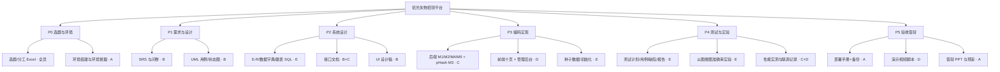
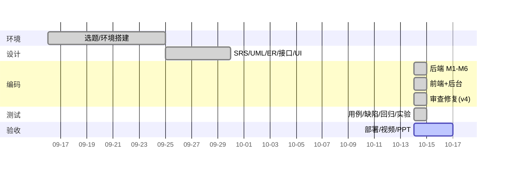

# 项目计划书 v1.0（WBS · 里程碑 · 风险）

> 交付物编号 03（成员A）。小组 5 人，按《五人分工方案》落位。

## 1. 项目概述
基于感知哈希(pHash)的校园失物招领平台：Spring Boot 3.3 + MyBatis-Plus + MySQL + Vue3；亮点=以图搜图 + 准确率实验。

## 2. WBS 任务分解

## 3. 里程碑与实际进度

| 里程碑 | 计划 | 实际 | 状态 |
|---|---|---|---|
| M0 选题与环境就绪 | W1 | 已完成（Maven/JDK21/MySQL/Node） | ✅ |
| M1 需求评审（SRS+UML 初稿） | W2 | 已完成（Creator/01-交付文档/01、02） | ✅ |
| M2 设计评审（E-R/接口/UI） | W3 | 已完成（Creator/01-交付文档/06、04、05） | ✅ |
| M3 可运行系统 v0.9（全栈跑通） | W7 | 已完成（后端 M1-M6 + 前端十页 + 60 启事种子） | ✅ |
| M4 测试完成（报告+实验） | W9 | 已完成（Creator/01-交付文档/07-11；现口径 141 断言 / 99 单测 / 12 vitest，实验数据实测） | ✅ |
| M5 验收（文档合稿/部署/视频/PPT） | W10 | 部署手册✅；视频/PPT 进行中 | 🔄 |

### 3.1 计划外增量批次（2026-10-15 ~ 10-17）

课程设计基线完成后，按"审查 → 修复 → 扩展"的节奏推进了四个增量批次（均有独立 Prompt 与修复记录）：

| 批次 | 内容 | 产出 |
|---|---|---|
| B/Z 批（10-15~16） | 外部审查整改：可见性、统计口径、错误码、参数校验、种子一致性、Z-01~Z-11 | 缺陷 #10~#28 全闭环 |
| E 批（10-16） | 账号设置、审核理由落库、私信双向、他人主页、封禁提示、收藏 | 八表（+favorite）、POST 断言 141 |
| P 批（10-17） | 文件交付（认领证明/报表/匹配报告）、桌面 Electron 壳、IPC 原生打开 | delivery 表、`ShiGuang Setup 1.0.1.exe` |
| M 批（10-17） | Android Capacitor 套壳 + iOS PWA | `app-release.apk`（1.0.2）、PWA |
| P3/F 批（10-17） | 公网穿透与后端托管前端；白屏与多端适配修复 | 在线站点、缺陷 #29~#32 |

> 说明：增量批次属于"超出课程基线"的工程打磨，计划书原始 WBS 与甘特图保留当时视角，增量明细以本节与
> `Creator/02-过程资料/03-迭代记录` 的修复记录为准。

## 4. 甘特图（实际执行，2026-10-14 视角）

## 5. 风险登记表

| # | 风险 | 概率 | 影响 | 应对 | 状态 |
|---|---|---|---|---|---|
| R1 | pHash 对旋转/裁剪失效被评委质疑 | 中 | 高 | 实验报告 11 量化边界+缓解方案（多图入库/拍摄引导/展望） | 已缓解 |
| R2 | 依赖拉取慢（JImageHash/JitPack） | 中 | 中 | 改用 Maven Central 版 dev.brachtendorf:1.0.0 + 阿里云镜像 | 已消除 |
| R3 | MySQL 8+ 时区/方言坑（XOR/^） | 已发生 | 高 | 团队规范沉淀；缺陷表 #1 留档 | 已消除 |
| R4 | 演示数据单薄 | 低 | 高 | 幂等播种 60 启事/120 条图片引用（30 个去重文件）/认领/消息/待审，一键重建 | 已消除 |
| R5 | 敏感信息进 git | 中 | 高 | application-local.yml + .gitignore + 占位符；05 C-01 清理误入库的调试凭据 `_admintoken.txt`/`_r.json` 并补 ignore 规则 | 已消除（2026-10-15 处置完毕） |
| R6 | 人员时间冲突（考试周） | 中 | 中 | 文档与脚本化测试降低回归成本；模块负责人制 | 监控中 |
| R7 | 演示设备环境差异 | 低 | 中 | 部署手册 12 统一 MAVEN_HOME/JAVA_HOME/工作目录；系统 JAVA_HOME 已永久指向 JDK21（2026-10-15），演示前仍须 `mvn -v` 确认 Java 21 | 已缓解（仍有踩坑风险，演示前检查） |

## 6. 周报模板与协作约定
- 周报三段式：本周完成 / 下周计划 / 风险与求助（每周日交成员A汇总）。
- 分支规范（git 就绪后执行）：main 可发布 / dev 集成 / feature-xxx 开发；提交信息 `模块: 做了什么`。
- 文档命名 `编号-名称-版本.md` 置于 docs/，改动者在群内知会。
