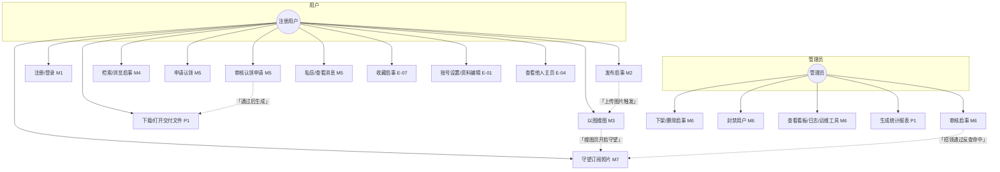
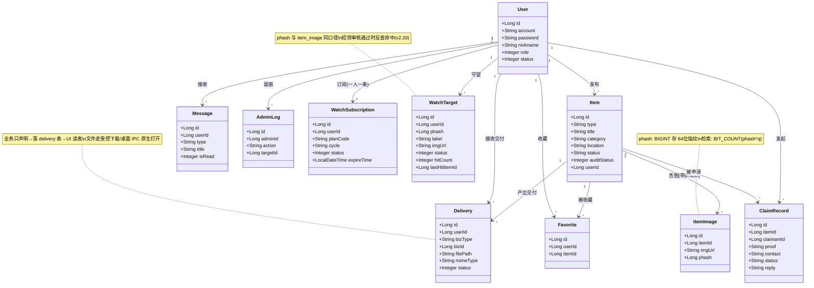
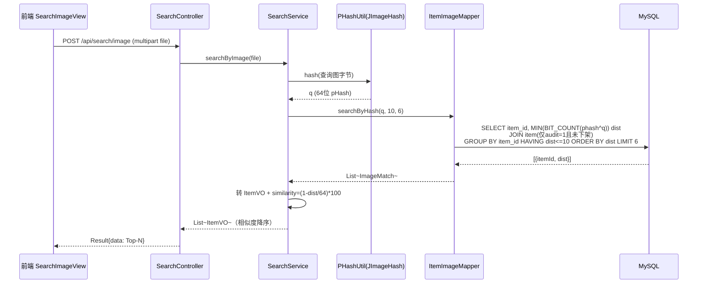
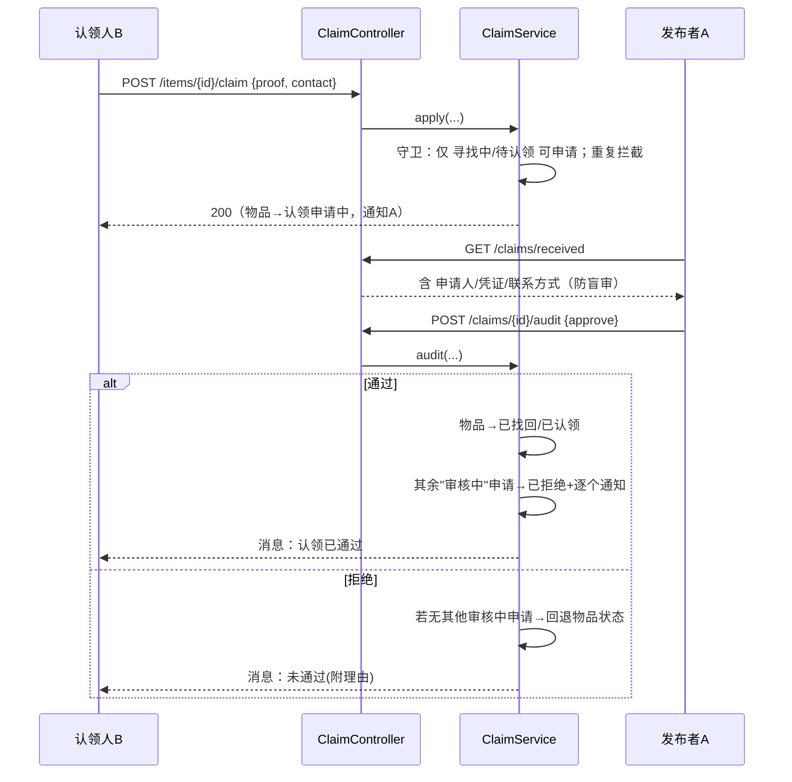
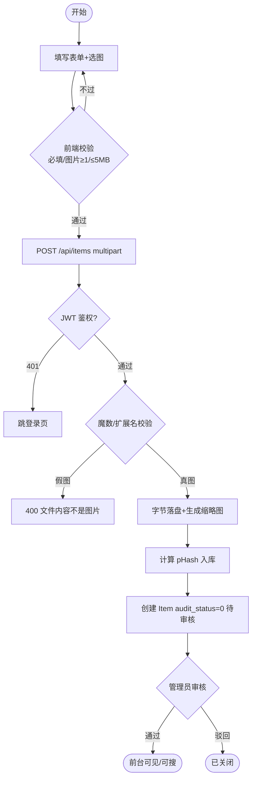
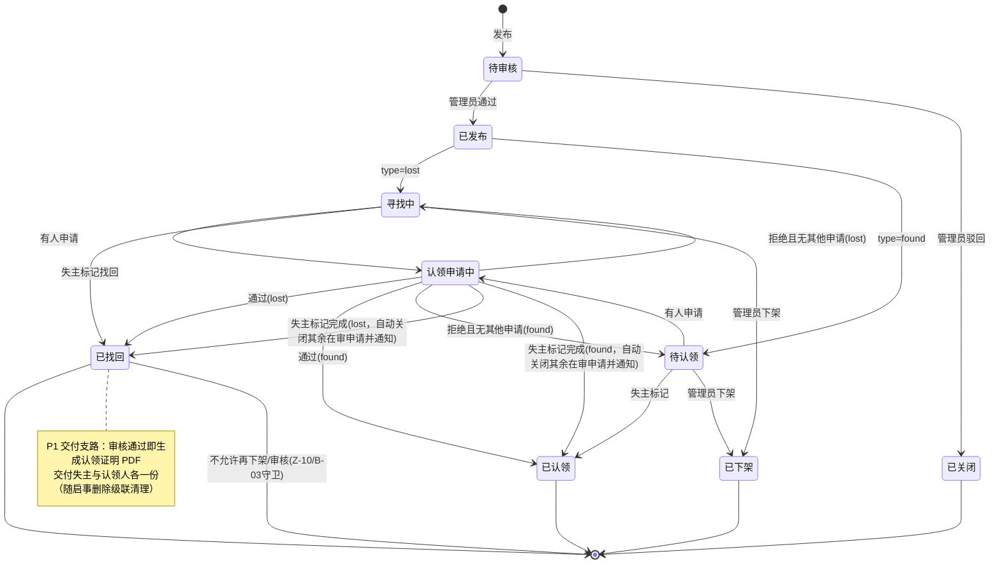
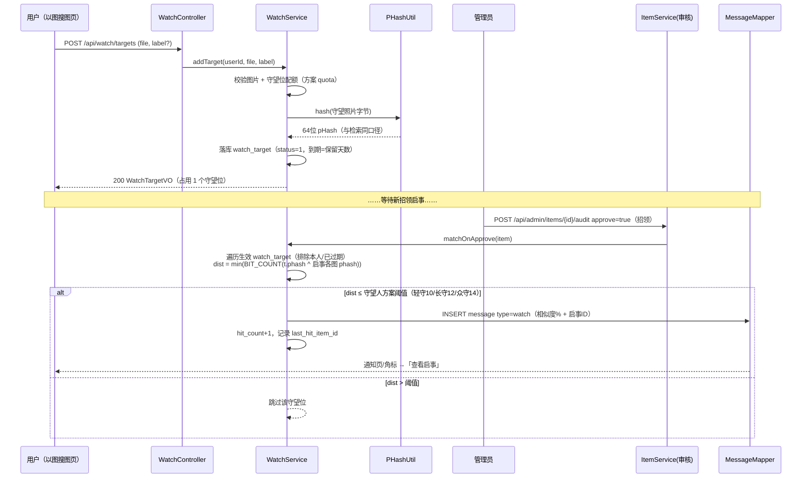

# UML 建模全套 v1.0

> **交付形态说明（05 B-08，2026-10-25 更新）**：七张图以 Mermaid 源码形式交付，**导出 PNG 见仓库 `model/` 目录（图2-1~图2-7）**；类图为核心域模型，为可读性省略时间戳等次要字段。
> 交付物编号 02（杜林峰）。全部图与真实代码一一对应（类名/方法名/接口路径可检索）。Mermaid 渲染：VSCode 装 Markdown Preview Mermaid 插件或 GitHub 在线预览。

## 1. 用例图

> E/P 批补充：收藏（E-07）、账号设置（E-01）、他人主页（E-04）、交付文件（P1：认领证明/报表/匹配报告）、
> 管理端统计报表（P1）。M 批多端（桌面壳/Android/PWA）不改变业务用例，属同一用例集合的运行形态——该形态已于 2026-10-17 下线，用例本身仍由 Web 端覆盖。
> M7 补充（v2.20）：守望订阅——搜图页上传守望照片占守望位，招领启事通过审核时反查 pHash 命中并写站内通知（时序见 §7）。

## 2. 类图（核心域模型）

服务层关键类（时序图参与者）：`AuthService` `ItemService` `SearchService` `ClaimService` `AdminService` `FileStorageService` `PHashUtil` `JwtUtil`；
E/P 批新增：`FavoriteService` `UserService`（改密/资料）`MessageService`（私信回复）`FileDeliveryService`（交付唯一入口）`PdfService`（认领证明/匹配报告）；
v2.20 新增：`WatchService`（守望订阅 / 审核通过反查命中推送）。

> 说明：E-07 收藏、P1 文件交付（delivery）对应的实体/关系已补入类图；对应的用例图补充见 §1 注记。

## 3. 以图搜图时序图（核心，M3）

## 4. 认领审核时序图（M5，含竞争申请处理）

## 5. 活动图（发布一条启事）

## 6. 物品状态图（M5 核心，与 ClaimService 逐分支对应）

> 注：实现中 `已发布` 与 `寻找中/待认领` 合并为初始业务状态（audit_status 与 status 两维正交：审核维度 0/1/2，业务维度如上）。

## 7. 守望订阅时序图（M7，v2.20）

> 与《01-SRS》FR-7 对应；方案数值由 `WatchService.PLANS` 唯一定义，前端经 `/api/watch/plans` 读取，避免两套数字各写一遍。
