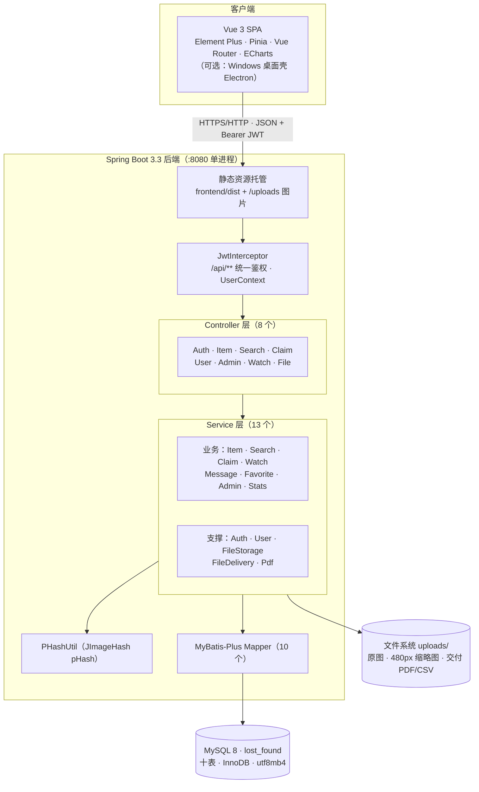

# 软件设计文档 v1.0

> 课程交付物 · 拾光 · 基于感知哈希的校园失物招领平台。
> 主笔：杜林峰（分析和设计及文档，244215322039）+ 张庆宏（项目经理，244215322026）；编码部分由张家豪 / 赵豪杰复核与代码对齐。
> 定位：**总设计**——先讲清体系结构、模块划分与技术决策，再索引到四份分册（02-UML / 04-接口 / 05-UI / 06-数据库）看细节。
> 体系结构图导出件：`model/图SD-1-系统体系结构图.png`。

---

## 1. 引言

### 1.1 目的
给出系统的总体结构设计与关键技术决策，使评审者不必通读全部文档即可建立完整设计图景；各领域的完整设计（UML 模型、接口清单、界面规范、数据字典）由分册承载，本文不重复展开。

### 1.2 与其他文档的关系
| 想看什么 | 去哪份文档 |
|---|---|
| 需求从哪来 | 《01-需求规格说明书》 |
| 用例 / 类图 / 时序 / 活动 / 状态图 | 《02-UML 建模全套》 |
| 每个 REST 端点的入参出参 | 《04-接口文档》（51 端点） |
| 页面布局 / 主题变量 / 交互规范 | 《05-UI 设计稿与规范》 |
| E-R / 数据字典 / 索引取舍 | 《06-数据库设计》（十表） |
| 算法为什么准 | 《11-以图搜图准确率实验报告》 |
| 怎么跑起来 | 《12-部署手册》+ `other/软件安装说明书》` |

---

## 2. 总体设计

### 2.1 体系结构

系统为**前后端分离开发、同源部署**的单体 Web 应用：开发期前端走 Vite（:5173）代理，部署期后端直接托管 `frontend/dist`，浏览器只访问一个端口（:8080）。



**分层规则**：Controller 只做参数校验与 Result 包装；业务规则、事务、状态机迁移全部在 Service（`@Transactional` 保证跨表一致）；Mapper 只承载数据访问。跨模块复用（如 pHash 计算、文件落盘、PDF 生成）收敛为独立支撑服务，禁止横向互调业务 Service。

### 2.2 运行形态

| 形态 | 组成 | 用途 |
|---|---|---|
| **Web 单机（主交付）** | 后端 jar 托管 dist + MySQL | 课程演示 / 校园部署；`java -jar` 单进程 |
| Web 公网演示（可选） | 上述 + cloudflared 临时隧道 | 任意网络访问的演示（免账号免流量费） |
| Windows 桌面版（可选） | Electron 壳 + 内置 JRE 21 + Spring Boot（H2 profile） | 免装 MySQL/JDK 的独立安装包，独立构建不影响 Web 版 |

### 2.3 关键技术决策

| # | 决策 | 理由 |
|---|---|---|
| D1 | pHash 指纹存 `item_image.phash BIGINT`，检索用 `BIT_COUNT(phash ^ q)` | 指纹即一列整数，检索即一条 SQL，零额外中间件；实测 54ms/张（数据量：千级图片） |
| D2 | phash **不建索引** | 检索条件是函数（XOR+BIT_COUNT），B+Tree 永不命中（EXPLAIN 证实），建索引只有写放大；规模大了改分段哈希预筛 |
| D3 | 表间**无物理外键**，一致性由 Service 层事务保证 | 简化课程环境部署与批量造数；删除启事 = item+image+claim+message+favorite+delivery 同事务 |
| D4 | JWT 无状态会话 + 全局拦截器 | 单机免 Session 复制；封禁即时生效（拦截器查 status）；`/auth/me` 对封禁返回专用码 40301 供前端提示 |
| D5 | 图片本体存文件系统，库只存路径 + 指纹 | 避免大对象撑爆数据库与 git 仓库；`uploads/yyyy/MM/uuid.ext` |
| D6 | 审核位（audit_status）与业务状态（status）两维正交 | 审核流转与认领流转解耦，状态机各管各的（见 02 §6） |
| D7 | 交付物（认领证明 PDF / 报表 CSV / 匹配报告）走统一 delivery 表 + 受控下载路由 | 业务只声明、UI 读表渲染；下载带 no-store/nosniff/CSP sandbox 三件套，越权 403 |
| D8 | 守望订阅复用以图搜图同一条 pHash 口径 | watch_target.phash 与 item_image.phash 同算法定义，命中阈值按方案分档（10/12/14） |
| D9 | 前端自研 i18n（约 90 行）而非引入 vue-i18n | 539 词条 × 3 语言足够，减一个运行时依赖 |

### 2.4 模块划分与负责人

| 模块 | 内容 | 后端 | 前端 | 负责人 |
|---|---|---|---|---|
| M1 用户 | 注册/登录/会话/账号设置/个人中心/他人主页 | AuthController · UserController | AuthView · ProfileView · UserProfileView | 张家豪 / 赵豪杰 |
| M2 发布 | 表单/图片上传/pHash 入库/缩略图/待审核 | ItemController · FileStorageService | PublishView | 张家豪 / 赵豪杰 |
| M3 以图搜图（核心） | 查询 pHash → 汉明距离 → Top-10 | SearchController · PHashUtil | SearchImageView | 张家豪 / 赵豪杰 |
| M4 检索 | 组合筛选/分页/详情/收藏 | ItemController · FavoriteService | WallView · DetailView | 张家豪 / 赵豪杰 |
| M5 认领与消息 | 申请/审核状态机/站内通知/私信/交付文件 | ClaimController · MessageService · PdfService | DetailView · NotificationsView · MessagesView | 张家豪 / 赵豪杰 |
| M6 管理后台 | 审核/下架/封禁/看板/日志/运维工具 | AdminController · StatsService | admin/ 五页 | 张家豪 / 赵豪杰 |
| M7 守望订阅（v2.20） | 三档方案/守望位/审核通过反查命中推送 | WatchController · WatchService | WatchView + 搜图页开关 | 张家豪 / 赵豪杰 |
| 横切 | JWT/异常/Result 包装/CORS/Knife4j | common · config · interceptor | — | 张家豪 |
| 测试与数据 | 测试四件套/实验/建表/种子/备份 | scripts + src/test | src/__tests__ | 牛贺群 |

> 文档分工：SRS/UML/接口/UI 主笔 = 杜林峰；计划书/部署/统筹 = 张庆宏；数据库设计/测试文档 = 牛贺群。

---

## 3. 接口设计概要

REST 风格，统一 `{code, msg, data}` 包装，BaseURL `/api`。共 **51 个端点**（另有 2 条 SPA 回退路由）：

| 域 | 端点数 | 代表 |
|---|---|---|
| 认证 M1 | 3 | register / login / me |
| 用户 | 12 | 改密 / 资料 / 收藏分页 / 消息 5 个 / 他人主页 2 个 / 统计 2 个 |
| 启事 M2/M4 | 9 | 列表筛选 / 详情 / 发布 multipart / 私信 / 收藏 2 个 |
| 搜图 M3 | 4 | image / indexed-count / reindex / match-report |
| 认领 M5 | 4 | 申请 / 我的 / 收到的 / 审核 |
| 管理后台 M6 | 11 | 审核 / 下架 / 封禁 / 看板 / 日志 / db-counts / 报表 |
| 守望 M7 | 5 | plans / me / subscribe / targets 增删 |
| 文件交付 P1 | 3 | list / download / delete |

逐端点的入参、出参、错误码与安全口径见《04-接口文档》。

## 4. 数据设计概要

`lost_found` 库共 **10 张表**：user / item / item_image（含 phash，检索核心）/ claim_record / message（type: claim·audit·dm·system·watch）/ admin_log / favorite / delivery / watch_subscription / watch_target。

三个设计要点：**① phash 不建索引**（D2）；**② 无物理外键 + Service 事务**（D3）；**③ 图片在库外**（D5）。完整 E-R 图与逐表数据字典见《06-数据库设计》。

## 5. 核心算法设计（M3 / M7 共用）

```
入库：图片字节 → BufferedImage → PerceptiveHash(64) → long 指纹 → item_image.phash
检索：查询图 → 同口径指纹 q → SELECT item_id, MIN(BIT_COUNT(phash ^ q)) AS dist
      FROM item_image JOIN item(仅 audit=1 且未下架)
      GROUP BY item_id HAVING dist <= 12 ORDER BY dist LIMIT 10
      → 相似度 = (1 - dist/64) × 100%
守望：新招领审核通过 → 取该启事全部 phash → 与生效 watch_target 逐位比对
      → 最小距离 ≤ 方案阈值（轻守10/长守12/众守14）→ 写 type=watch 站内通知
```

阈值 12 / Top-10 由网格扫描标定（召回 85.7% 且误检 0），标定过程与 aHash/dHash 横评见《11-实验报告》。算法边界（大角度旋转）已量化并写入答辩预案。

## 6. 前端设计概要

设计系统 v3 双语境（详见《05-UI 设计规范》）：**登录前**北欧编辑风（4 屏固定舞台翻页 + 弹层面板）；**登录后** Digg 信息流三栏（232px 左导航 / 中信息流 / 300px 右信息栏）。亮/暗双主题、简/繁/英三语、`prefers-reduced-motion` 全量尊重。组件骨架：AppShell / AppSidebar / FeedRail / FeedCard / ItemCard。

## 7. 安全设计

| 层面 | 措施 |
|---|---|
| 认证 | BCrypt 口令；JWT 有效期 30 天/1 天；连续错 5 次锁 10 分钟 |
| 授权 | 拦截器统一鉴权；越权一律 403/404（待审核启事对非本人返回 404 防探测） |
| 注入 | MyBatis-Plus 预编译；无字符串拼接 SQL |
| 上传 | 扩展名 + 魔数双重校验；单图 5MB / 请求 20MB；落盘 uuid 重命名 |
| 下载 | delivery 受控路由：仅本人（管理员豁免）、MIME 白名单、三件套响应头、路径穿越拦截 |
| 配置 | 数据库口令 / JWT secret 外置 application-local.yml（不入 git） |

## 8. 部署与运行

单机一条命令（详见《12-部署手册》与 `other/软件安装说明书》`）：建库（schema-init.sql）→ 生成 application-local.yml → `mvn spring-boot:run`（自动播种 60 启事并重算 pHash）→ 浏览器访问 :8080。备份用 `scripts/backup.sh`；重置用 schema.sql（会清库）。
